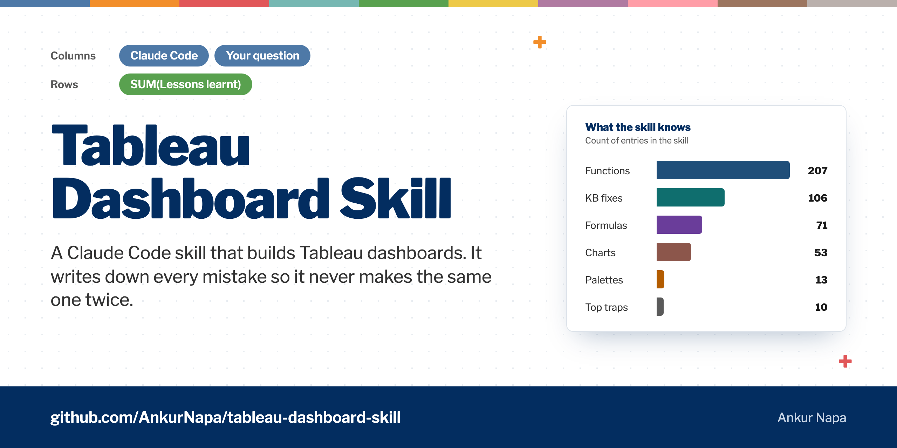

# Tableau Dashboard Skill



A Claude Code skill that builds Tableau dashboards. It writes down every mistake so it never makes the same one twice.

Use it with Claude Code (or any agent that reads Agent Skills) to write Tableau calculated fields, LOD expressions (FIXED, INCLUDE, EXCLUDE) plus table calculations, pick the right chart, design a dashboard that passes accessibility checks, debug a number that looks wrong, publish with the REST API or TSC, build Tableau Data Apps through Tableau MCP and script .twb workbooks.

If it saves you an hour, a star helps other Tableau developers find it.

I built it from my own Tableau notes, then checked it against official Tableau sources. It knows:

| What | Count | Source |
|------|------:|--------|
| Functions with syntax, example and source limits | 207 | help.tableau.com |
| Fixes for numbers that look wrong | 106 | Tableau Knowledge Base articles |
| Ready formulas for business questions | 71 | Tableau help plus derived patterns |
| Chart recipes, shelf by shelf | 53 | Tableau help plus derived recipes |
| Colour palettes as .tps files | 13 | House, accessible, beverage |
| Brewery, winery and distillery dashboard builds | 30 | My own Tableau work |

Every entry is labelled "official", "verified" or "derived". Test anything derived before a client sees it.

## Install

```bash
git clone https://github.com/AnkurNapa/tableau-dashboard-skill ~/.claude/skills/tableau-dashboard
```

Claude Code picks it up on the next start. Ask for a Tableau dashboard, a formula or a chart, or type `/tableau-dashboard`.

## Colour palettes

Copy `palettes/Preferences.tps` to `~/Documents/My Tableau Repository/Preferences.tps` then restart Tableau. If you already have custom palettes, paste the `<color-palette>` blocks into your own file. One file per family sits beside it if you only want some.

## How it learns

Before each build it reads `references/lessons.md`. After each build it logs any mistake there. A mistake that repeats becomes one of the Top traps in `SKILL.md`, which every calculation is checked against. Pull this repo to get new lessons as they land.

## What is not here

My notes from a commercial Tableau book stay private, so the public copy has no `cookbook.md`.

I'm a Tableau Ambassador (unpaid). Views are my own.
